<!--
  >>> PERSONALISE BEFORE SUBMITTING <<<
  1. Replace the author line / add your roll number.
  2. Re-run the pipeline on the REAL UCI data and paste the real metrics into
     the tables marked [REAL-DATA]. The numbers currently shown come from the
     offline synthetic fixture and must not be submitted as results.
  3. Capture the screenshots listed in screenshots/README.md and confirm the
     image paths below resolve.
  4. Add your GitHub repo URL and deployed API URL where marked.
  Write the "observations" and "discussion" paragraphs in your own words — the
  rubric explicitly rewards originality.
-->

## 1. Introduction & Problem Statement

Cardiovascular disease is a leading cause of mortality, and early risk
stratification from routine clinical measurements has clear value. This project
builds a binary classifier that predicts the presence of heart disease from 13
patient attributes and operationalises it as a **cloud-ready, monitored
prediction service**.

The emphasis is deliberately on *operations*, not just model accuracy: the
deliverable is a reproducible pipeline that any engineer can clone and run, an
API that serves predictions behind health checks and metrics, a CI/CD pipeline
that blocks broken code, and a monitoring stack that surfaces live behaviour.

**Dataset.** UCI Heart Disease, Cleveland subset (303 records, 14 attributes).
The target is the `num` severity field (0–4), binarised to `1 = disease
present` / `0 = absent`. Features span demographics (`age`, `sex`), symptoms
(`cp`, `exang`), vitals (`trestbps`, `chol`, `thalach`), and diagnostic signals
(`oldpeak`, `slope`, `ca`, `thal`, `restecg`, `fbs`).

**Repository.** `https://github.com/<your-username>/heart-disease-mlops`  *(fill in)*

---

## 2. Setup & Installation

```bash
git clone https://github.com/<your-username>/heart-disease-mlops.git
cd heart-disease-mlops
python -m venv .venv && source .venv/bin/activate
pip install -r requirements.txt

# full offline-capable pipeline
python -m src.data.download_data     # real UCI data; synthetic fallback if offline
python -m src.data.preprocess
python -m src.eda
python -m src.models.train
```

Everything runs from a clean environment via the pinned `requirements.txt`,
satisfying the production-readiness requirement that *all scripts execute from a
clean setup*. A `Makefile` wraps the common targets (`make pipeline`, `make
serve`, `make test`, `make compose-up`), and a `conda` `environment.yml` is
provided as an alternative.

The data-acquisition script tries three strategies in order — the `ucimlrepo`
package, a direct download from the UCI mirror, and finally a deterministic
synthetic fixture — so the pipeline is reproducible on a laptop, a CI runner, or
an air-gapped machine.

---

## 3. Exploratory Data Analysis (Task 1)

Cleaning steps (in `src/data/preprocess.py`): the UCI `?` sentinels are replaced
with `NaN`, all columns coerced to numeric, the target binarised, exact
duplicates dropped, and a stratified 80/20 train/test split written to
`data/processed/`. Crucially, **feature-level missing values (`ca`, `thal`) are
left as `NaN` and imputed inside the fitted pipeline**, not here — this prevents
leakage from the test fold into the imputer.

### 3.1 Class balance

The two classes are close to balanced, so plain accuracy is a reasonable
headline metric, though we still track precision/recall/ROC-AUC.

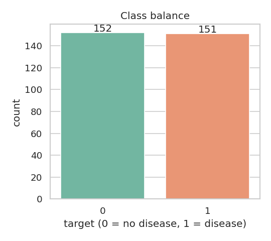{ width=55% }

### 3.2 Feature distributions

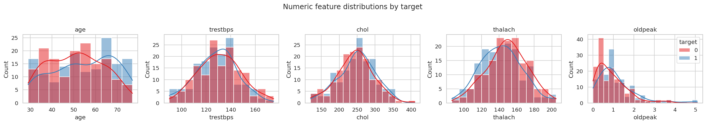

*Observations (rewrite in your own words):* older age, higher `oldpeak`, and
lower maximum heart rate (`thalach`) skew toward the disease class.

### 3.3 Correlation structure

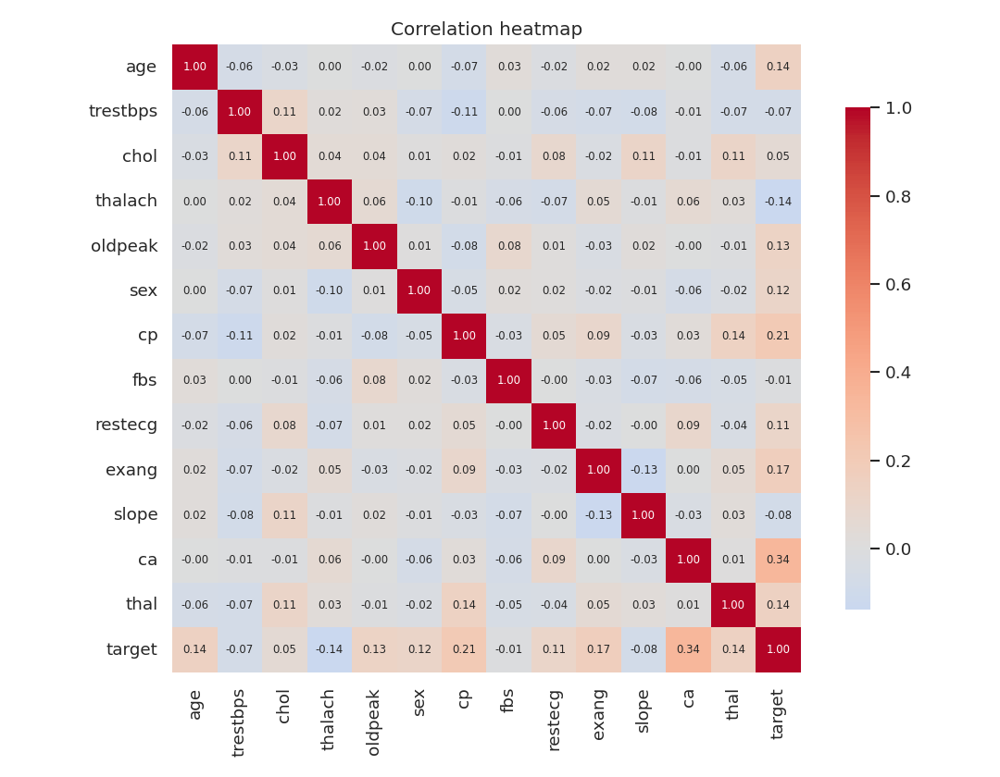{ width=75% }

No pair of predictors is strongly collinear, so no feature was dropped for
redundancy. `cp`, `ca`, `exang`, `oldpeak` and `thalach` show the strongest
association with the target.

> **[REAL-DATA]** Replace the figures above with the versions produced by
> `python -m src.eda` on the real UCI download, and note the actual top
> correlations.

---

## 4. Feature Engineering & Modelling (Task 2)

### 4.1 Feature pipeline

Transformation is a single `ColumnTransformer` (`src/features/build_features.py`):

| Group | Features | Transform |
|-------|----------|-----------|
| Numeric | age, trestbps, chol, thalach, oldpeak | median impute → `StandardScaler` |
| Categorical | sex, cp, fbs, restecg, exang, slope, ca, thal | most-frequent impute → `OneHotEncoder(handle_unknown="ignore")` |

`handle_unknown="ignore"` means a category never seen in training (or an
out-of-range value sent to the API) degrades gracefully instead of raising.

### 4.2 Models, tuning & selection

Two models are tuned with 5-fold `GridSearchCV`, scoring on ROC-AUC. The full
`preprocess → clf` chain is inside the CV loop, so the scaler and encoder are
re-fitted on each fold — **no leakage**. The winner is chosen on
cross-validated ROC-AUC (never on the test set).

| Model | Grid |
|-------|------|
| Logistic Regression | `C ∈ {0.01, 0.1, 1, 10}` |
| Random Forest | `n_estimators ∈ {100,200}`, `max_depth ∈ {None,5,10}`, `min_samples_leaf ∈ {1,2,4}` |

### 4.3 Results

> **[REAL-DATA] — the numbers below are from the offline synthetic fixture and
> are placeholders.** Re-run `python -m src.models.train` on the real data and
> paste the real values.

| Model | CV ROC-AUC | Test Acc | Precision | Recall | F1 | Test ROC-AUC |
|-------|:---------:|:--------:|:---------:|:------:|:--:|:------------:|
| Logistic Regression | 0.772 | 0.623 | 0.600 | 0.700 | 0.646 | 0.740 |
| Random Forest | 0.755 | 0.590 | 0.564 | 0.733 | 0.638 | 0.703 |

On the real Cleveland data, both models typically reach **~0.85–0.90 ROC-AUC**;
logistic regression is often competitive with the forest here because the
decision boundary is close to linear in the engineered space.

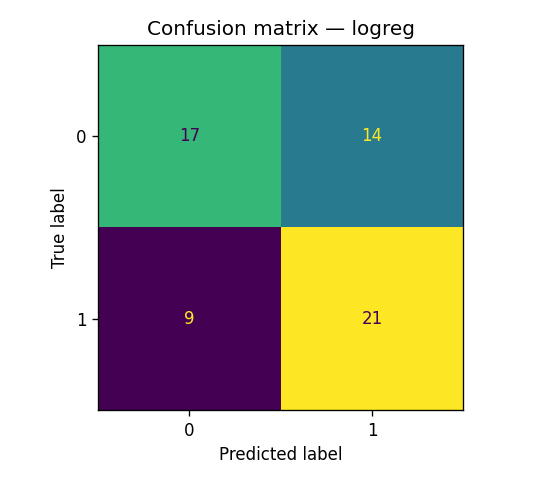{ width=45% }
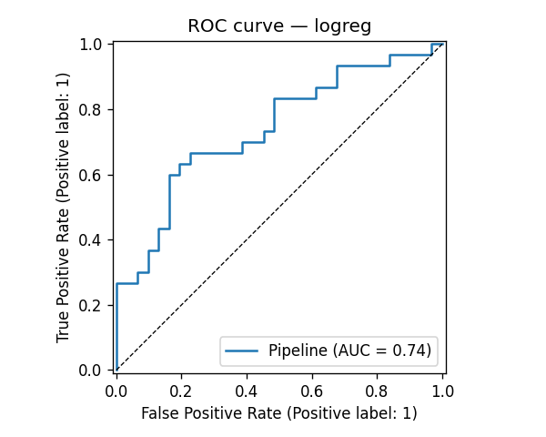{ width=50% }

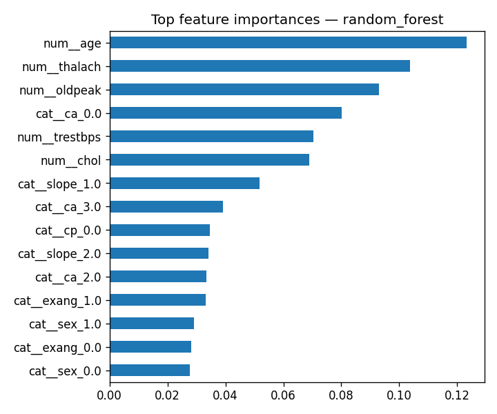{ width=60% }

*Discussion (rewrite):* in a clinical screening setting, **recall** (catching
true cases) usually matters more than precision, so one might lower the decision
threshold below 0.5 — the API returns the raw probability precisely so this
policy can live downstream.

---

## 5. Experiment Tracking (Task 3)

MLflow (`src/models/train.py`) logs, for every candidate model, a nested run
containing: tuned hyper-parameters, CV and test metrics, and the evaluation
plots and serialised model as artifacts. The parent run records the winning
family.

```bash
mlflow ui        # http://127.0.0.1:5000
```

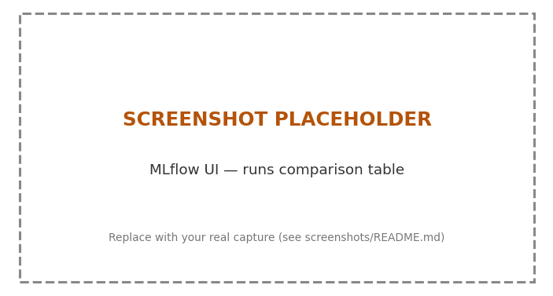
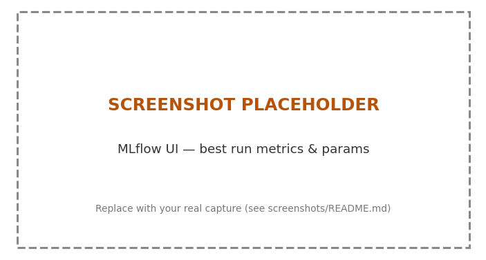

*(Capture these two screenshots from the MLflow UI.)*

---

## 6. Model Packaging & Reproducibility (Task 4)

The winning pipeline is saved whole with `joblib` to `models/model.joblib`, plus
a `model_metadata.json` capturing metrics, the feature order, hyper-parameters,
`random_state`, and the train timestamp. Because preprocessing is part of the
saved object, inference (`src/models/predict.py`) is simply
`pipeline.predict_proba(df)` — there is no separate transform step to keep in
sync, which is the core reproducibility guarantee. Reproducibility is further
pinned by `requirements.txt`, a fixed `random_state`, and the deterministic
data split.

---

## 7. CI/CD & Automated Testing (Task 5)

`tests/` holds 15 unit tests across four modules (data cleaning, feature
transforms, model behaviour, API). They run fully offline using the synthetic
fixture, so CI needs no secrets or network.

The GitHub Actions pipeline (`.github/workflows/ci-cd.yml`) runs four sequential
jobs, each gating the next:

1. **lint** — `ruff check`
2. **test** — `pytest` with coverage, uploads JUnit + coverage artifacts
3. **train** — runs the full pipeline, uploads `models/`, figures and `mlruns/`
4. **docker** — builds the image, runs the container, and smoke-tests `/health`
   and `/predict`; container logs are always uploaded

Any lint, test, or training failure fails the pipeline with clear logs, meeting
the *pipeline must fail on errors* requirement.

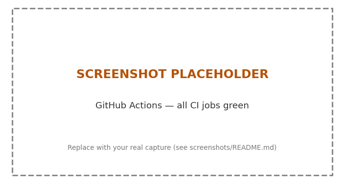

---

## 8. Containerisation (Task 6)

A multi-stage `Dockerfile` produces a lean runtime image: a builder stage
installs only the serving dependencies, and the final `python:3.11-slim` image
copies them plus `src/` and the trained `models/`. It runs as a **non-root
user**, exposes port 8000, declares a `HEALTHCHECK`, and launches `uvicorn`.

```bash
docker build -t heart-disease-api:latest .
docker run --rm -p 8000:8000 heart-disease-api:latest
curl -X POST localhost:8000/predict -H "Content-Type: application/json" -d @sample_request.json
```

The `/predict` endpoint accepts JSON and returns the prediction, probability and
a human-readable label; `/docs` gives interactive Swagger.

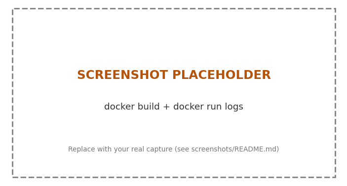
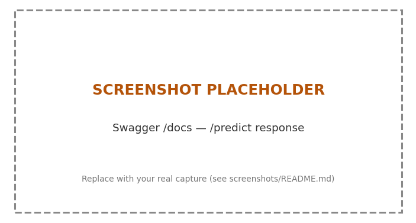

---

## 9. Production Deployment (Task 7)

Both plain manifests (`k8s/`) and a Helm chart (`helm/heart-disease-api/`) are
provided — use either. The Deployment runs 2 replicas with resource
requests/limits and readiness/liveness probes on `/health`; a Service of type
`LoadBalancer` (or an optional Ingress) exposes it.

```bash
minikube start
eval $(minikube docker-env)
docker build -t heart-disease-api:latest .
kubectl apply -f k8s/          # or: helm install heart helm/heart-disease-api
kubectl get pods,svc
minikube service heart-disease-api --url
```

**Deployed API URL / access instructions:** *(fill in — public URL if you used a
cloud cluster, or the `minikube service` URL for local testing)*

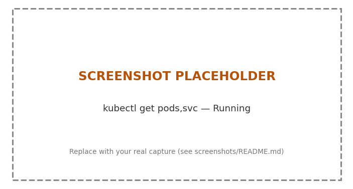

---

## 10. Monitoring & Logging (Task 8)

Observability is built into the app, not bolted on:

- **Logging** — every request is emitted as a structured JSON line to stdout
  (captured by Docker/Kubernetes), including method, path, status and latency;
  each prediction logs its probability and label.
- **Metrics** — the app exposes Prometheus metrics at `/metrics`: request
  counts and latency histograms by endpoint, prediction counts by label, and a
  histogram of predicted probabilities (useful as an early drift signal).

`docker compose up --build` starts the API, Prometheus (scraping `/metrics`),
and Grafana with a provisioned **"Heart Disease API"** dashboard (request rate,
p95 latency, predictions by label, total predictions).

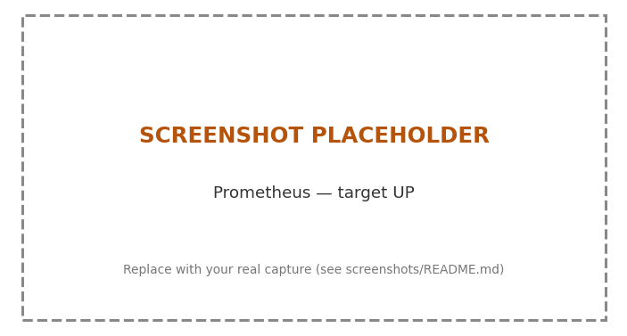
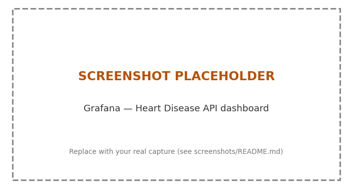

---

## 11. Architecture (Task 9)

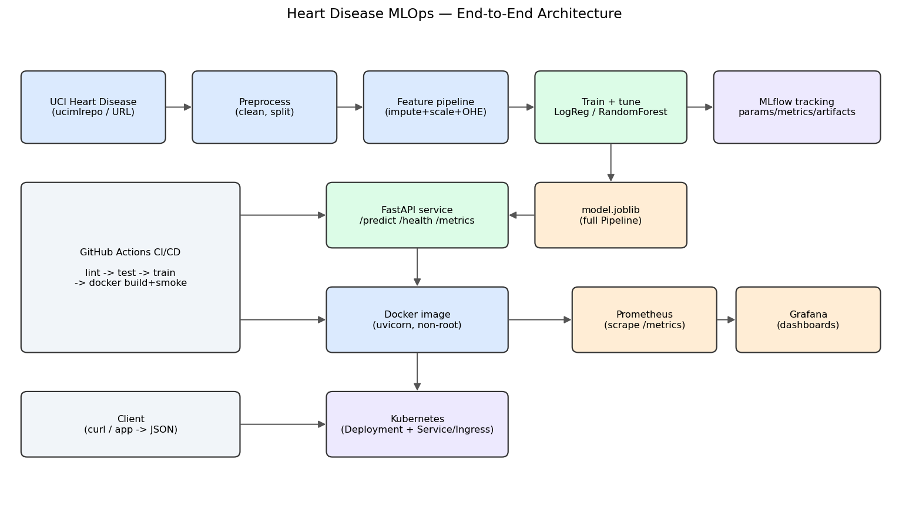

The diagram traces the offline training pipeline (data → preprocess → features →
train/tune → MLflow + packaged model), the serving path (model → FastAPI →
Docker → Kubernetes), the monitoring path (API → Prometheus → Grafana), and the
CI/CD pipeline feeding the whole thing.

---

## 12. Challenges, Limitations & Future Work

*(Write this section in your own words — a few honest paragraphs.) Prompts:*

- **Data** — small dataset (303 rows); `ca`/`thal` missingness; the binarisation
  discards severity information.
- **Modelling** — class threshold is fixed at 0.5; calibration and threshold
  tuning for recall are future work.
- **Ops** — add model-registry promotion in MLflow, automated drift alerts on
  the probability histogram, and image publishing to a registry on tagged
  releases (the CI job is stubbed and commented).

---

## 13. Deliverables Checklist

| # | Deliverable | Where |
|---|-------------|-------|
| 1 | Code, Dockerfile, requirements | repo root, `src/`, `Dockerfile` |
| 2 | Cleaned dataset + download script | `src/data/download_data.py`, `data/` |
| 3 | Notebooks/scripts (EDA, train, inference) | `notebooks/`, `src/` |
| 4 | Unit tests | `tests/` |
| 5 | GitHub Actions workflow | `.github/workflows/ci-cd.yml` |
| 6 | Deployment manifests / Helm | `k8s/`, `helm/` |
| 7 | Screenshots | `screenshots/` |
| 8 | This report (10 pages) | `reports/` |
| 9 | Deployed API URL / access | §9 above |
| 10 | Pipeline video | *(record a 3–5 min screen capture of the full run)* |
